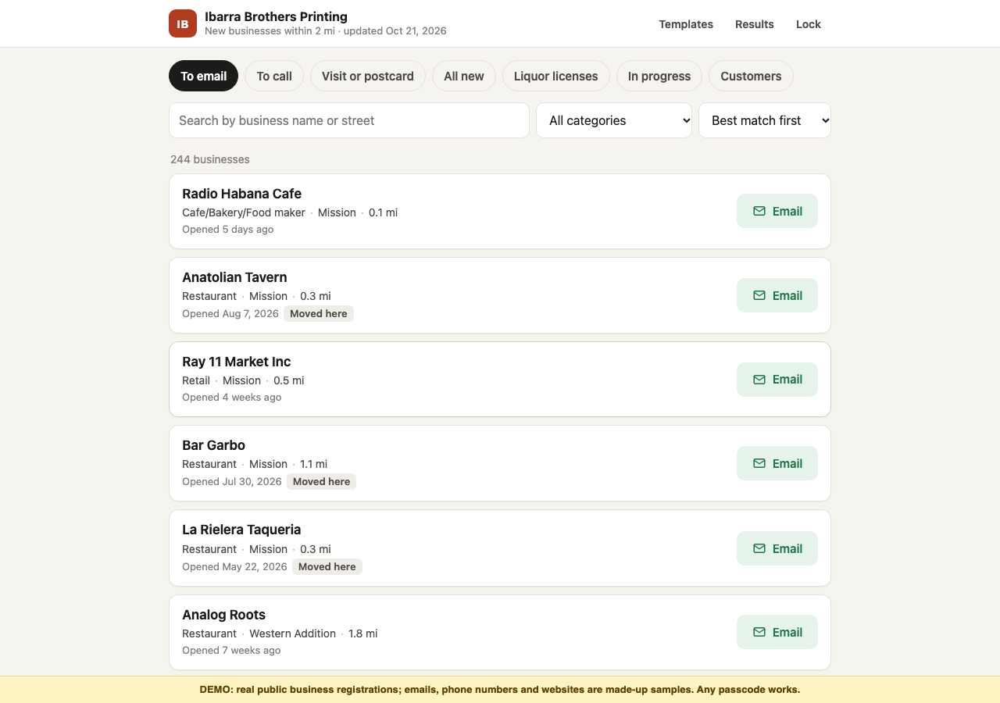
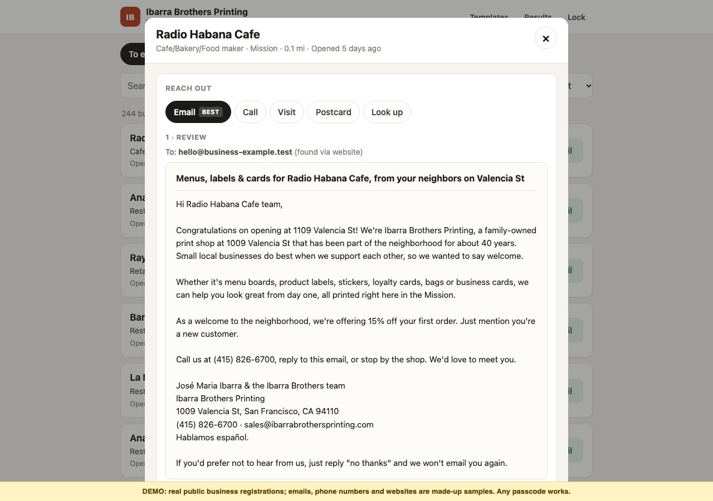
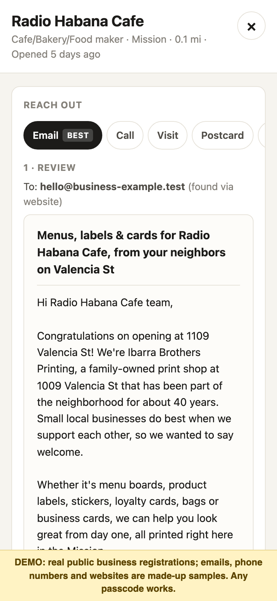

# Ibarra Leads

A new-business lead finder for **Ibarra Brothers Printing**, a print shop at 1009 Valencia St, San Francisco.

Every morning it finds businesses that have just registered within 2 miles of the shop, ranks them, looks for contact details within free or capped budgets, and drafts a tailored outreach email. It also imports California liquor-license applications citywide to catch new owners, upcoming openings and businesses adding alcohol. Staff review and send every email themselves. **Nothing is ever sent automatically.**

Built by **Lucie** ([@lucie-batista](https://github.com/lucie-batista)) in October 2026.

## The problem

Ibarra Brothers Printing is a family print shop on Valencia St. When I met with the shop, two things stood out:

- **Their customer base is shrinking.** Many of their regular customers are local businesses that are closing down because of macroeconomic conditions.
- **Word of mouth was their only way of getting new customers.** There was no process for finding new business proactively.

So instead of focusing on the businesses the shop was losing, I decided to target the ones that are **just opening**. New businesses need a lot of printing (menus, signage, business cards, flyers) and haven't picked a printer yet. But they're hard to spot early: they don't have websites or listings, and by the time they're visible, they've often already found someone. San Francisco and California publish new business registrations and liquor-license applications as open data, but nobody at a small shop has time to watch those feeds, work out which entries matter, and find a way to reach each one.

Ibarra Leads does that every morning and turns it into a short, ranked list of businesses to contact, with a drafted email ready to review. It gives the shop a repeatable way to find new customers beyond word of mouth.

## What it does

- **Finds new businesses daily** from San Francisco's Registered Business Locations dataset (2 mi radius, rolling 180-day window), deduplicated and kept up to date with closures and late records.
- **Classifies leads** by category (from NAICS codes, license types and name cues), home-based vs storefront, and new opening vs move.
- **Ranks leads** with an explainable points score (category + recency + distance + best contact − home-based penalty; restaurants weigh most). All weights are editable.
- **Finds contact details** through Google Places, then Claude Haiku 4.5 with web search, then an email crawl of the business website. Each paid service has daily and monthly caps.
- **Picks a best next action** for each lead: Email → Call → Visit (if nearby) → Postcard → Look up.
- **Drafts category-specific emails** from editable templates, ready to send from the shop's own mail account.
- **Tracks outreach** (Emailed / Called / Visited / Mailed → Replied → Customer) without the daily refresh ever overwriting staff edits.
- **Imports liquor-license applications** from CA ABC "New Applications" reports to spot openings before they appear in the business registry.
- **Passcode-protected web app** that works on desktop and phone.

## Demo and screenshots

**[Try the interactive demo](https://lucie-batista.github.io/ibarra-leads/demo/)** (any passcode works). It runs the real UI in the browser on real public business registrations, with made-up emails, phone numbers and websites. Nothing is sent or saved.

| Leads to contact, best first | Drafted email, ready to review |
|---|---|
|  |  |



_Works on phones too._

## How it works

The whole system runs on Google Apps Script, with a Google Sheet as the database.

```
data.sf.gov (g8m3-pdis) ──► Apps Script (bound to the "Ibarra Leads" Google Sheet)
                              ├─ Leads.js     ingest (whole 2 mi / 180-day window, upsert, dedupe)
                              ├─ Classify.js  NAICS/license/name → category, home-based, new vs moved
                              ├─ Score.js     explainable points score (weights in Config tab)
                              ├─ Contacts.js  Google Places → Claude web search → website email crawl
                              ├─ Pipeline.js  daily trigger, caps, continuation, locking, logging
                              ├─ Licenses.js  CA ABC New Applications CSVs (Drive folder "ABC reports") → Liquor licenses tab
                              ├─ Templates.js email templates (Templates tab, editable by staff)
                              ├─ Auth.js      passcode (salted hash) + session tokens
                              ├─ Api.js       JSON-style API for the UI (session-checked)
                              └─ Code.js + Index/Styles/App.html  web app UI (HtmlService)
```

- **Backend and UI are separate.** Everything in `Api.js` returns plain JSON, so the UI could move to a static host behind a `doPost` endpoint without changing the backend.
- **The Google Sheet is the database:**

| Tab | Contents |
|---|---|
| Leads | One row per business. System columns first, staff columns (status, notes, drafts…) last. |
| Config | Every tunable number (radius, weights, caps) |
| Templates | Email and script wording |
| Log | Run history and errors |
| Usage | Daily paid-lookup counts |

### Daily pipeline (`dailyRun`, time trigger 6–7 AM Pacific)

1. **Refresh.** Fetch every registration in the window (`within_circle` + `location_start_date`), collapse duplicates (same name + address, preferring open records), and upsert by `ttxid`.
   - Re-pulling the whole window makes runs idempotent and catches late-arriving records and closures.
   - The pipeline writes only system columns, so staff edits are never overwritten.
2. **Rescore** all leads (recency changes daily) and sort the Leads tab by score.
3. **Repair** any invalid saved emails.
4. **Contact lookups** for the best unchecked leads:
   - Google Places Text Search. A result is accepted only at the same street number with a shared name word.
   - Claude Haiku 4.5 + web search (≤2 searches) when Places has no match and the category is in `claude_categories`.
   - Website crawl for emails: respects robots.txt, decodes Cloudflare-protected addresses, validates.
5. **Continuation.** A 2-minute continuation trigger is scheduled before work starts and removed when nothing remains, so a run killed by Apps Script's 6-minute limit resumes by itself.

### Cost controls (Config tab; enforced from the Usage tab)

| Setting | Default | Why |
|---|---|---|
| `places_daily_cap` / `places_monthly_cap` | 30 / 900 | Google gives 1,000 free Enterprise Text Search calls per month |
| `claude_daily_cap` / `claude_monthly_usd_cap` | 5 / $3 | Keeps prepaid Claude credit lasting months |
| `*_catchup_remaining` | one-time | Extra lookups for the first backfill; count down to 0 |

When a service fails (no key, out of credit, HTTP 403/429), the run logs it and continues without that service. Leads keep their Search / Visit / Mail actions.

## Tech stack

- **Google Apps Script** (V8 JavaScript), HtmlService web app, time-driven triggers
- **Google Sheets** as the datastore; **Google Drive** for license report uploads
- **APIs:** SF Open Data (Socrata), Google Places API (New) Text Search, Anthropic Claude API (Haiku 4.5 with web search)
- **Tooling:** [clasp](https://github.com/google/clasp) for deploys; Node.js test harness that emulates the Apps Script services; Python for data analysis and a pre-deploy secret scan; Playwright for UI screenshots

## Repository layout

| Path | Contents |
|---|---|
| `src/` | Apps Script source (what clasp pushes) |
| `tests/` | Node tests and an in-memory Apps Script emulator (`harness.js`); `tests/preview/` builds a static UI preview |
| `scripts/` | Data analysis (`abc_analyze.py`, `m2_contact_test.py`, `preview_classify.js`) and the pre-deploy `secret_scan.py` |
| `data/` | Raw public downloads used by the tests and analysis (see [Data](#data)) |
| `docs/` | README screenshots and the static demo served by GitHub Pages |
| `DECISIONS.md` | Every design decision, the options considered, and why |
| `METRICS.md` | Measured numbers: contact hit rates, pipeline runs, costs |
| `HANDOFF.md` | Plain-language user guide written for the shop |

## Running the tests locally

The tests need only **Node.js** and `curl`. No Google account or API keys: `tests/harness.js` emulates the Apps Script services in memory (including Sheets' date conversion), fetches live data from data.sf.gov, and stubs Places and Claude.

```bash
git clone git@github.com:lucie-batista/ibarra-leads.git
cd ibarra-leads

node tests/harness.js                # full setup + second run (idempotency)
node tests/api_test.js               # passcode, sessions, lockout, edits survive a refresh
node tests/caps_test.js              # Places/Claude caps and catch-up
node tests/usage_reconcile_test.js   # caps against a realistic Usage state
node tests/migration_test.js         # schema migration keeps staff columns aligned
node tests/licenses_test.js          # imports the CA ABC CSVs in data/
node scripts/preview_classify.js data/window-2mi-180d.json   # category mapping preview
```

Scripts and tests read `data/` by default. Set `IBARRA_DATA=/some/folder` to use a different data folder.

To rebuild the demo, run `node tests/preview/build_preview.js --public` and copy `data/preview/index.html` to `docs/demo/`. The `--public` flag leaves out home-based registrations and owner names. Screenshots come from `python3 tests/preview/screenshots.py <tag>` (needs Playwright).

## Deploying your own copy

You need a Google account, Node.js, and clasp 3 (`npm i -g @google/clasp`).

1. Log in: `clasp login` (credentials are stored in `~/.clasprc.json`, outside the repo).
2. Create a Sheets-bound project: `clasp create-script --type sheets --rootDir src`. This writes `.clasp.json` (gitignored; see `.clasp.json.example` for the shape). Then run `clasp push`.
3. Create the first deployment with `clasp create-deployment` and save its ID to `~/ibarra-secrets/deployment.id`.
4. In the Apps Script editor, open **Project Settings → Script Properties** and add:

   | Property | Value |
   |---|---|
   | `GOOGLE_PLACES_API_KEY` | `<your Google Places API key>` |
   | `ANTHROPIC_API_KEY` | `<your Anthropic API key>` |
   | `PASSCODE_NEW` | `<a passcode for the web app>` (hashed and removed on the next page load) |

   Both API keys are optional: without them the pipeline skips that lookup and logs it.
5. In the editor, run **`setup`** once. It creates the tabs, installs the daily trigger and runs the first refresh.

For later updates, use the deploy script. It runs the secret scan, pushes, and updates the **existing** deployment so the web app URL never changes:

```bash
./deploy.sh "what changed"
```

To change the shop location, radius, score weights or caps, edit the **Config** tab in the Sheet.

### Changing the Leads schema
- System columns must stay **before** staff columns.
- Add new system columns before `status`, and new staff columns at the end. `migrateLeadColumns_` inserts missing columns in place.

## Data

`data/` contains raw downloads from public sources, kept so the analysis and tests are reproducible:

- `window-2mi-180d.json`, `probe-90d.json`: SF Registered Business Locations (DataSF dataset `g8m3-pdis`, `https://data.sf.gov/resource/g8m3-pdis.json`)
- `CA-ABC-LicenseReport*.csv`: California Department of Alcoholic Beverage Control "New Applications" reports

These are public records and include registrants' names and some home or mailing addresses. Contact details found by the lookup services are **not** included and are gitignored.

## Security

- No credentials live in the repo. API keys and the passcode hash are stored in Apps Script Script Properties.
- `scripts/secret_scan.py` runs before every deploy and fails on API-key/token patterns, credential files, and unexpected phone numbers.
- Every API call from the UI is session-checked server-side, with a 15-minute lockout after 10 wrong passcode attempts.

## Known limitations and possible upgrades

- **Contact coverage is low by nature:** brand-new businesses often have no web presence yet. Measured: about 23% of leads get a usable contact and about 13% an email ([METRICS.md](METRICS.md)). The tool falls back to Call / Visit / Mail / Search.
- **mailto length:** links over about 1,900 characters open with the subject only, and the body is copied to the clipboard.
- **One-click sending (not built):** a Zoho Mail API integration would allow sending from the app, at the cost of OAuth token upkeep and more risk. Manual review-and-send is a deliberate requirement.
- **AI personalization (not built):** an on-demand "Personalize with AI" button using Haiku 4.5, cached per lead, falling back to the template. Estimated cost about $0.002 per draft.
- **Other ideas:** a Spanish UI toggle, a weekly summary email, a map view.
- **Apps Script banner:** consumer Apps Script web apps show "This application was created by a Google Apps Script user". Moving the UI to a static host would remove it.

## Author

Designed and built by **Lucie** ([@lucie-batista](https://github.com/lucie-batista)).
